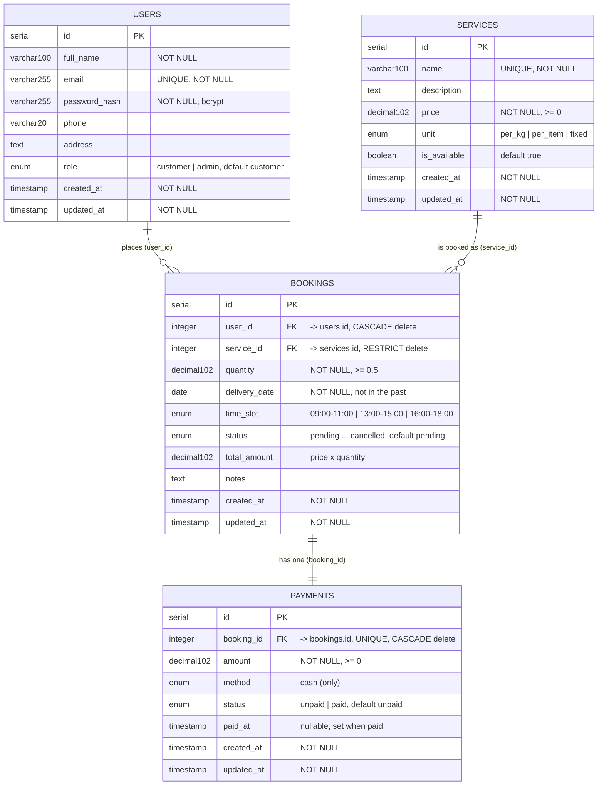

# LaundryHops — ERD & Data Dictionary

**Owner:** Regie Inding (documentation) · **Schema owner:** Christian Mark Baje
**Database:** PostgreSQL · **ORM:** Sequelize (`backend/src/models`, `backend/migrations`)

---

## 1. Entity-Relationship Diagram



Indexes: `bookings(delivery_date, time_slot)` (slot availability), `bookings(status)` (filters), `payments(status)` (revenue reports), plus unique indexes on `users.email`, `services.name`, `payments.booking_id`.

---

## 2. Data Dictionary

### 2.1 `users`

| Column | Type | Null | Default | Key / Constraint | Description |
|---|---|---|---|---|---|
| `id` | `SERIAL` | no | auto | PK | Surrogate identifier. |
| `full_name` | `VARCHAR(100)` | no | — | not empty | Customer/admin display name. |
| `email` | `VARCHAR(255)` | no | — | UNIQUE, valid email | Login identifier. |
| `password_hash` | `VARCHAR(255)` | no | — | bcrypt, cost 10 | Never exposed by the API. |
| `phone` | `VARCHAR(20)` | yes | `NULL` | — | Contact number. |
| `address` | `TEXT` | yes | `NULL` | — | Pickup / customer address. |
| `role` | `ENUM` | no | `customer` | `customer` \| `admin` | Authorization level. |
| `created_at` | `TIMESTAMP` | no | now | — | Audit: creation time. |
| `updated_at` | `TIMESTAMP` | no | now | — | Audit: last update. |

> `password` is a `VIRTUAL` model field (validation only, 6–100 chars); it is hashed in a `beforeValidate`/`beforeCreate` hook and never persisted.

### 2.2 `services`

| Column | Type | Null | Default | Key / Constraint | Description |
|---|---|---|---|---|---|
| `id` | `SERIAL` | no | auto | PK | Surrogate identifier. |
| `name` | `VARCHAR(100)` | no | — | UNIQUE | e.g. "Wash & Fold". |
| `description` | `TEXT` | yes | `NULL` | — | Marketing copy shown in the catalog. |
| `price` | `DECIMAL(10,2)` | no | — | ≥ 0 | Price in PHP (₱) per unit. |
| `unit` | `ENUM` | no | `per_kg` | `per_kg` \| `per_item` \| `fixed` | How quantity is interpreted. |
| `is_available` | `BOOLEAN` | no | `true` | — | Disabled services cannot be booked. |
| `created_at` | `TIMESTAMP` | no | now | — | Audit. |
| `updated_at` | `TIMESTAMP` | no | now | — | Audit. |

### 2.3 `bookings`

| Column | Type | Null | Default | Key / Constraint | Description |
|---|---|---|---|---|---|
| `id` | `SERIAL` | no | auto | PK | Surrogate identifier. |
| `user_id` | `INTEGER` | no | — | FK → `users.id`, `ON DELETE CASCADE` | Customer who booked. |
| `service_id` | `INTEGER` | no | — | FK → `services.id`, `ON DELETE RESTRICT` | Booked service. |
| `quantity` | `DECIMAL(10,2)` | no | — | ≥ 0.5 | Kg or item count (supports half-kg). |
| `delivery_date` | `DATE` | no | — | not in the past | Day the customer brings laundry to the shop. |
| `time_slot` | `ENUM` | no | — | one of 3 slots | Drop-off window; capacity 5 per date+slot. |
| `status` | `ENUM` | no | `pending` | state machine | Order tracking state. |
| `total_amount` | `DECIMAL(10,2)` | no | `0` | = `service.price × quantity` | Amount due in PHP. |
| `notes` | `TEXT` | yes | `NULL` | — | Customer remarks (e.g. fabric care). |
| `created_at` | `TIMESTAMP` | no | now | — | Audit. |
| `updated_at` | `TIMESTAMP` | no | now | — | Audit. |

**Status flow** (enforced in `backend/src/constants.js`):

```text
pending → confirmed → received → washing → ready → delivered
                                                  ↘ claimed

pending   → cancelled
confirmed → cancelled
```

| Status | Meaning | Payable? |
|---|---|---|
| `pending` | Booked, awaiting admin confirmation. | no |
| `confirmed` | Accepted; customer should drop off. | no |
| `received` | Laundry physically received at the shop. | no |
| `washing` | Being processed. | no |
| `ready` | Ready for pickup / delivery. | **yes** |
| `delivered` | Handed to customer. | **yes** |
| `claimed` | Picked up at the shop. | **yes** |
| `cancelled` | Cancelled by the customer before processing. | no |

### 2.4 `payments`

| Column | Type | Null | Default | Key / Constraint | Description |
|---|---|---|---|---|---|
| `id` | `SERIAL` | no | auto | PK | Surrogate identifier. |
| `booking_id` | `INTEGER` | no | — | FK → `bookings.id`, UNIQUE, `ON DELETE CASCADE` | One payment per booking. |
| `amount` | `DECIMAL(10,2)` | no | — | ≥ 0 | Mirrors `bookings.total_amount`. |
| `method` | `ENUM` | no | `cash` | `cash` only | Cash on claim/delivery. |
| `status` | `ENUM` | no | `unpaid` | `unpaid` \| `paid` | Settlement state. |
| `paid_at` | `TIMESTAMP` | yes | `NULL` | — | Set when admin records payment. |
| `created_at` | `TIMESTAMP` | no | now | — | Audit. |
| `updated_at` | `TIMESTAMP` | no | now | — | Audit. |

**Rules:** a payment row is created automatically with every booking (`unpaid`), deleted when the booking is cancelled, and may only be marked `paid` while the booking is `ready`, `delivered`, or `claimed`.

---

## 3. Referential Integrity Summary

| Relationship | Cardinality | FK | On update | On delete |
|---|---|---|---|---|
| User → Bookings | 1 : N | `bookings.user_id` | CASCADE | CASCADE |
| Service → Bookings | 1 : N | `bookings.service_id` | CASCADE | RESTRICT |
| Booking → Payment | 1 : 1 | `payments.booking_id` | CASCADE | CASCADE |

`RESTRICT` on `services` protects history: a service with bookings cannot be deleted (the API returns `409` and suggests disabling it with `is_available = false`).

---

## 4. Seeded Reference Data

| Service | Price | Unit |
|---|---|---|
| Wash & Fold | ₱60 | per kg |
| Wash & Iron | ₱90 | per kg |
| Dry Cleaning | ₱120 | per item |
| Comforters & Beddings | ₱150 | per item |
| Express Service | ₱100 | per kg |

Demo accounts: `admin@laundryhops.com / admin123` (admin), `juan@example.com / juan123` (customer).

---

## 5. Recreating the Schema

```bash
cd backend
npm run db:create     # create the laundryhops database
npm run db:migrate    # run the four migrations
npm run db:seed       # demo users + services
# or, from scratch:
npm run db:reset
```

Migration files:

| File | Table |
|---|---|
| `20261111000001-create-users.js` | `users` |
| `20261111000002-create-services.js` | `services` |
| `20261111000003-create-bookings.js` | `bookings` (+ indexes) |
| `20261111000004-create-payments.js` | `payments` (+ index) |
